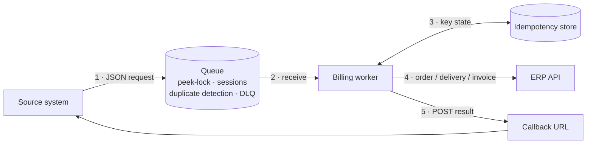

# ERP Billing Integration Tests


Integration tests for a **message-driven billing worker** that reads requests from a queue, creates
documents in an ERP (sales order → delivery → invoice) and sends the result back through a callback.

The main question these tests answer is the one that matters most in billing:

> **Can the same request ever produce a second fiscal document?**

Queues deliver messages *at least once*, workers crash, ERPs time out after committing. Each one of
those is a way to bill a customer twice. This project reproduces each failure on purpose and proves
the integration still creates **exactly one** set of documents.

**74 automated tests** · **98% line coverage** · fault injection · contract tests with JSON Schema ·
negative-control tests that prove every safeguard is actually needed.

> **About this project.** It is inspired by my work in 2026 as a QA consultant on an ERP billing
> automation project for a large company. The domain, data, code and design details here are
> fictional and generic. **No client information is included.**

## The system under test



Everything runs **in-process**, so the suite needs no Docker, broker or ERP license:

| Component | Implementation | What it models |
|---|---|---|
| Queue | [`src/broker/queue.js`](src/broker/queue.js) | Peek-lock, lock expiry and renewal, delivery count, dead-letter queue, duplicate detection by `messageId`, sessions (FIFO, one consumer per customer) |
| Worker | [`src/worker/billing-worker.js`](src/worker/billing-worker.js) | Envelope validation, idempotency, reconciliation after failures, business vs. technical errors, callback |
| ERP | [`src/erp/app.js`](src/erp/app.js) | Express API with business rules (blocked customer, credit limit, catalog) and a test-only fault injection endpoint |
| Contracts | [`src/contracts/`](src/contracts) | JSON Schemas for the request and the callback |

### The safeguards being tested

| Safeguard | Protects against |
|---|---|
| Broker duplicate detection (`messageId = idempotencyKey`) | The source system sending the same request twice |
| Idempotency store (`IN_PROGRESS → COMPLETED / FAILED`), written **before** the first ERP call | Redelivery of a message that was already processed |
| Reconciliation: on a retry, look up the ERP by reference before creating anything | A crash or a timeout **after** the ERP committed a document |
| Lock renewal during long ERP calls | A second worker picking up a message that is still being processed |
| Broker sessions (`sessionId = customerId`) | Two requests for the same customer running at the same time |

## Test strategy

The full strategy, with the risk analysis and the failure-point matrix, is in
[docs/TEST_STRATEGY.md](docs/TEST_STRATEGY.md). In short:

| Risk | Impact | Suite | Tests |
|---|---|---|---|
| **R1** · A second fiscal document is created | Customer billed twice, tax and legal exposure | [`duplicate-protection`](test/duplicate-protection.test.js) | 12 |
| **R2** · Errors are misclassified (business errors retried, technical errors dropped) | Wasted retries, or billing silently lost | [`error-handling`](test/error-handling.test.js) | 8 |
| **R3** · The requester cannot trust or parse the result | Operation stuck, manual follow-up | [`callback-contract`](test/callback-contract.test.js) | 8 |
| **R4** · A malformed request reaches the ERP | Wrong documents, data cleanup | [`envelope-contract`](test/envelope-contract.test.js) | 22 |
| **R5** · The ERP test double drifts from the expected behavior | Tests pass for the wrong reason | [`erp-api`](test/erp-api.test.js) | 14 |
| Baseline flows | Regression | [`happy-path`](test/happy-path.test.js) | 4 |
| **Test validity** · a safeguard test that can never fail | False confidence | [`negative-control`](test/negative-control.test.js) | 6 |

Techniques used:

- **Risk-based testing**: test effort follows the impact of each risk, so R1 gets the most scenarios.
- **Fault injection**: worker crashes at each step, ERP outages, timeouts *after* commit, slow ERP calls, callback endpoint down.
- **Equivalence partitioning and boundary value analysis**: item count `0 / 1 / 50 / 51`, quantity `0 / 1 / 9999 / 10000`, key length `7 / 8 / 64 / 65`, credit limit `= limit / limit + 1 cent`.
- **State transition testing** of the idempotency record (`none → IN_PROGRESS → COMPLETED | FAILED → IN_PROGRESS`).
- **Contract testing** with JSON Schema (Ajv) for every callback status, including tests showing the schema rejects broken results.
- **Negative control**: each safeguard is switched off and the same scenario is replayed. It **must** create a duplicate. That proves the protection tests can fail, so a green run means something.

### Example: the scenario that matters most

```
Given the worker created the sales order in the ERP
And the worker process dies before saving its progress
When the broker redelivers the message after the lock expires
Then the worker finds the existing sales order by its reference
And it creates only the missing delivery and invoice
And the ERP holds exactly 1 sales order, 1 delivery and 1 invoice for that request
```

The same scenario **without reconciliation** creates 2 sales orders. The negative-control suite checks that.

## Project structure

```
├── .github/workflows/integration-tests.yml   # CI: tests, coverage gate, HTML report
├── docs/TEST_STRATEGY.md                     # Risks, failure-point matrix, scenario catalog
├── src/
│   ├── broker/queue.js                       # In-memory peek-lock queue
│   ├── contracts/                            # Request and callback JSON Schemas + validator
│   ├── erp/app.js                            # Fake ERP (Express) with fault injection
│   └── worker/                               # Billing worker, ERP client, idempotency store
└── test/
    ├── support/harness.js                    # Wires ERP, queue, workers and callback receiver
    ├── support/builders.js                   # Request builder, crash hooks, time windows
    └── *.test.js                             # 7 suites, 74 tests
```

## Getting started

**Requirements:** Node.js 22 or later.

```bash
git clone https://github.com/patrick-aguiar-qa/erp-billing-integration-tests.git
cd erp-billing-integration-tests
npm install
npm test
```

| Command | What it does |
|---|---|
| `npm test` | Runs all 74 tests (about 8 seconds) |
| `npm run test:report` | Runs the suite and creates `mochawesome-report/mochawesome.html` |
| `npm run coverage` | Runs the suite with coverage and fails below 95% lines / 85% branches |

Every test starts its own ERP and callback receiver on random local ports, so the suites are
independent and can run in any order.

## Author

**Patrick Aguiar** — QA Engineer · [LinkedIn](https://www.linkedin.com/in/patrick-aguiar-qa) · [GitHub](https://github.com/patrick-aguiar-qa)
